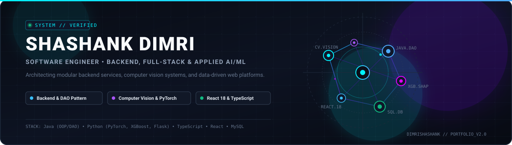
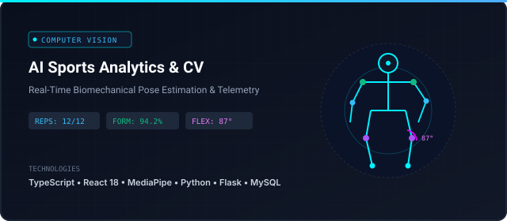
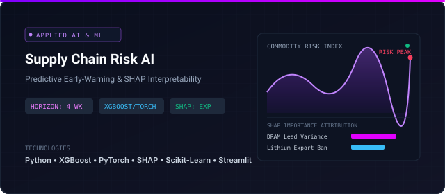
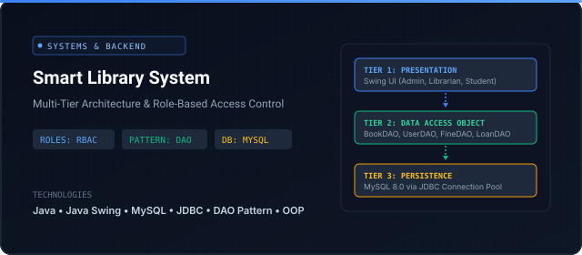
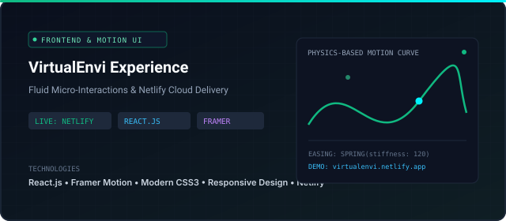

  

  
  
  
  

  

## 👨‍💻 Engineering Profile

I am a software engineer focused on building reliable, end-to-end software systems. My work bridges structured backend architectures, object-oriented systems design, and applied machine learning models for computer vision and predictive risk intelligence.

- **Backend Architecture & Data Access:** Designing modular systems using clean Data Access Object (DAO) patterns, relational database persistence (MySQL), and structured RESTful service contracts.
- **Applied Machine Learning & CV:** Implementing practical ML systems—from real-time biomechanical pose estimation and joint-angle tracking (MediaPipe) to supply-chain risk forecasting with explainable AI (XGBoost, PyTorch, SHAP).
- **Modern Full-Stack Engineering:** Developing responsive, component-driven user interfaces using TypeScript, React 18, and Tailwind CSS backed by Python and Java application services.

*Actively seeking Software Engineering, Backend Developer, Full-Stack, and Applied AI/ML internship and entry-level opportunities.*

  

## 🚀 Featured Engineering Projects

### 1. AI Sports Performance & Biomechanics Platform

  

- **Repository:** [dimrishashank/Ai-Sports-platform](https://github.com/dimrishashank/Ai-Sports-platform)
- **Problem Statement:** Athletic performance evaluation often relies on subjective observation or manual repetition logging, resulting in undetected biomechanical deviations and unmeasured athletic fatigue.
- **Engineered Solution:** Formulated an end-to-end analytics platform executing real-time body landmark detection, automated repetition counting, form deviation scoring, and joint-angle telemetry.
- **Key Technical Highlight:** Couples a MediaPipe computer vision inference pipeline with a Flask REST API backend and a high-performance React 18 / TypeScript interface with Bun and Tailwind CSS.
- **Core Stack:** `TypeScript` `React 18` `Python` `Flask` `MediaPipe` `MySQL` `Tailwind CSS`

---

### 2. Supply Chain Disruption Risk Intelligence Framework

  

- **Repository:** [dimrishashank/Supply-Chain-Disruption-Prediction](https://github.com/dimrishashank/Supply-Chain-Disruption-Prediction)
- **Problem Statement:** Modern electronics and clean-energy supply chains suffer from abrupt disruption across critical raw materials without sufficient early-warning telemetry.
- **Engineered Solution:** Formulated a predictive risk framework forecasting commodity supply shocks across DRAM, Neon, Copper, and Lithium within an actionable 4-week forecast horizon.
- **Key Technical Highlight:** Benchmarks XGBoost gradient-boosted trees against PyTorch neural classifiers, incorporating SHAP feature attribution to provide transparent, interpretable risk signals.
- **Core Stack:** `Python` `XGBoost` `PyTorch` `SHAP` `Scikit-Learn` `Streamlit` `Pandas`

---

### 3. Smart Library Management System (Enterprise Architecture)

  

- **Repository:** [dimrishashank/Library-Management-System](https://github.com/dimrishashank/Library-Management-System)
- **Problem Statement:** Institutional resource systems require strict permission boundaries, transactional consistency, and auditable checkout lifecycles without SQL leakage into presentation code.
- **Engineered Solution:** Built a multi-tier management desktop application supporting Administrators, Librarians, and Students with dedicated operational dashboards, hold requests, and fine calculations.
- **Key Technical Highlight:** Implements strict 3-tier Data Access Object (DAO) patterns decoupling Java Swing UI components from relational persistence in MySQL via JDBC.
- **Core Stack:** `Java` `Java Swing` `MySQL` `JDBC` `DAO Pattern` `OOP Architecture`

---

### 4. VirtualEnvi — Interactive Experience Platform

  

- **Repository:** [dimrishashank/virtualenvi](https://github.com/dimrishashank/virtualenvi) | **Live Application:** [virtualenvi.netlify.app](https://virtualenvi.netlify.app)
- **Problem Statement:** Engineering performant, visually engaging web interfaces that retain smooth transitions across diverse viewport sizes and bandwidth constraints.
- **Engineered Solution:** Developed a mobile-first responsive frontend platform featuring fluid layout animations, modular component composition, and automated cloud delivery.
- **Key Technical Highlight:** Leverages Framer Motion for declarative physics-based UI transitions and micro-interactions, continuously deployed on Netlify.
- **Core Stack:** `React.js` `JavaScript` `Framer Motion` `CSS3` `Netlify`

  

## 🛠️ Technical Competencies

| Engineering Domain | Technologies &amp; Frameworks |
|---|---|
| **Programming Languages** | Java, Python, TypeScript, JavaScript, SQL, HTML5/CSS3 |
| **Backend &amp; Systems** | Flask, JDBC, RESTful API Design, Data Access Object (DAO) Pattern, OOP |
| **Machine Learning &amp; CV** | PyTorch, XGBoost, MediaPipe (Pose Estimation), SHAP (Explainable AI), Scikit-Learn |
| **Frontend Engineering** | React 18, Tailwind CSS, Framer Motion, Component-Driven Composition |
| **Data &amp; Developer Tools** | MySQL, Git, GitHub, Bun, Netlify, Vite, Jupyter Notebooks |

  

## 📐 Core Engineering Principles

- **Decoupled Architecture:** Enforcing clean separation between presentation, domain models, and persistence layers for long-term maintainability and testability.
- **Model Explainability:** Treating interpretability (SHAP, feature attribution) as a first-class requirement in applied machine learning pipelines.
- **Type Safety &amp; Contracts:** Utilizing TypeScript and strongly typed Java domain models to prevent runtime regressions and maintain explicit API boundaries.

  

## 📬 Contact &amp; Collaboration

- **GitHub:** [@dimrishashank](https://github.com/dimrishashank)
- **Direct Email:** [shashanklucky190@gmail.com](mailto:shashanklucky190@gmail.com)
- **Location:** Open to Remote &amp; On-Site Software Engineering Roles
